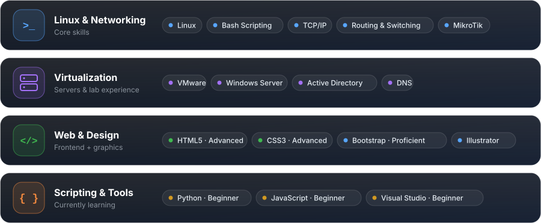
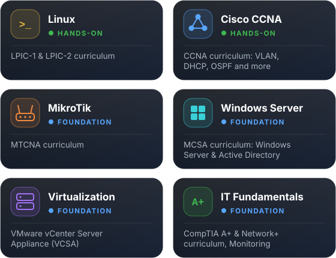
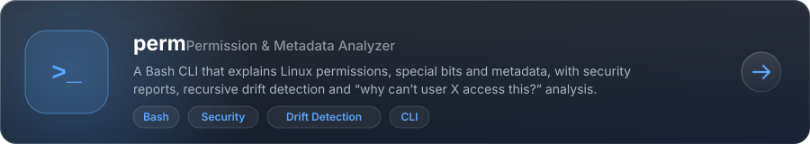
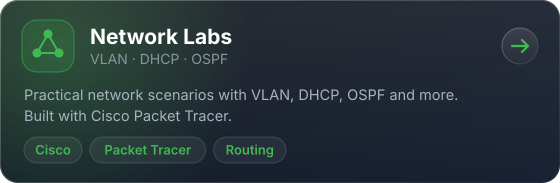
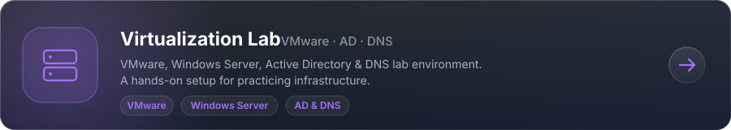

<div align="center">




<p>
  
</p>

</div>

```bash
kourosh@linux:~$ whoami
Kourosh — IT student, Linux & networking enthusiast

kourosh@linux:~$ cat roles.txt
Network Administrator | Linux System Administrator | IT Support

kourosh@linux:~$ echo $MOTTO
Building practical labs, writing tools, and documenting what I learn.
```


<h3 align="center">⚙️ Skills</h3>

<p align="center">
  
</p>


<h3 align="center">🎓 Training &amp; Coursework</h3>

<p align="center"><sub>Comprehensive IT infrastructure course (institute-issued certificates, not vendor exams). Hands-on focus on <b>Linux</b> and <b>CCNA</b>.</sub></p>

<p align="center">
  
</p>


<h3 align="center">📁 Featured Projects</h3>

<p align="center">
  <a href="https://github.com/Kourosh-NF/perm"></a>
  <br/><br/>
  <a href="https://github.com/Kourosh-NF/Network-Labs"></a>
  <br/><br/>
  <a href="https://github.com/Kourosh-NF/Virtualization-Lab"></a>
</p>


<h3 align="center">🔭 Currently Exploring</h3>

<p align="center">
  🐧 Linux system administration and automation<br/>
  🌐 Network troubleshooting and performance tuning<br/>
  🏗️ Virtualization and infrastructure design<br/>
  🐍 Python &amp; JavaScript fundamentals for automation
</p>


<h3 align="center">📊 GitHub Stats</h3>

<div align="center">
  
  
</div>


<h3 align="center">🔗 Get in Touch</h3>

<p align="center">
  <a href="mailto:kouroshnf87@gmail.com">
    
  </a>
  <a href="https://t.me/albernfnx">
    
  </a>
  <a href="https://github.com/Kourosh-NF">
    
  </a>
</p>

<br/>

<div align="center">
  <code>Thanks for visiting my profile! >_</code>
</div>
