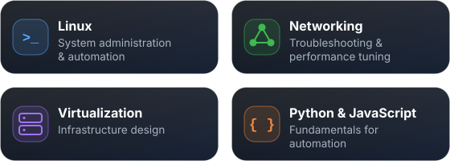

  

  

  

  

Comprehensive IT infrastructure course (institute-issued certificates, not vendor exams). Hands-on focus on <b>Linux</b> and <b>CCNA</b>.

  

  
    
  
    
  

  

  
  
  

  

